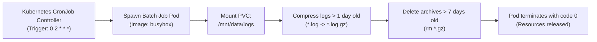

# ☸️ Kubernetes Volume Log Cleaner CronJob

> **Target Role:** Platform Operations / Kubernetes Engineering  
> **Technologies:** Kubernetes (`batch/v1 CronJob`), Bash, Linux POSIX  
> **Difficulty:** Intermediate  
> **Enterprise Level:** Production-Hardened  

---

## 💥 The Real-World Incident Story

Your production Kubernetes cluster is running an intensive e-commerce application. Suddenly, Pods across the cluster start evicting with `NodeHasDiskPressure`. Workloads fail to schedule, and your customer shopping carts start erroring out.

**Root Cause:** Legacy applications writing unrotated logs directly to an attached Persistent Volume Claim (PVC) ran out of storage and inode capacity.

This Kubernetes CronJob deploys an ultra-lightweight container (`busybox`) every night, mounts the shared volume, compresses historical `.log` files, and prunes stale archives exceeding your company's retention policy.

---

## 🧰 Kubernetes Architecture & Spec Explained



### Key CronJob Fields Explained:

| YAML Key | Production Value | What It Does |
| :--- | :--- | :--- |
| `schedule` | `"0 2 * * *"` | Standard cron syntax: minute 0, hour 2 (2 AM UTC every single day). |
| `concurrencyPolicy` | `Forbid` | Prevents a new job from starting if yesterday's run is still processing (avoids race conditions on the volume). |
| `successfulJobsHistoryLimit` | `3` | Automatically cleans up finished Pods so your Kubernetes API is not cluttered with thousands of dead job objects. |
| `runAsNonRoot: true` | Security Best Practice | Prevents container breakouts by running as UID `10001` instead of `root`. |
| `readOnlyRootFilesystem: true` | Security Best Practice | Ensures the container root cannot be tampered with; only the mounted volume is writable. |

---

## 🧪 Safe Sandbox: Test Locally with Docker

You don't need a live Kubernetes cluster to test the cleanup logic. Run this one-liner using Docker:

```bash
# 1. Create a mock directory with sample old and new logs
mkdir -p /tmp/test-k8s-logs
touch -d "10 days ago" /tmp/test-k8s-logs/stale.log.gz
touch -d "3 days ago" /tmp/test-k8s-logs/old-app.log
touch /tmp/test-k8s-logs/today.log

# 2. Run the script inside Docker mounted to the mock directory
docker run --rm -v /tmp/test-k8s-logs:/var/log/app busybox /bin/sh -c "
  echo 'Running cleanup inside container...';
  find /var/log/app -type f -name '*.gz' -mtime +7 -exec rm -f {} +;
  find /var/log/app -type f -name '*.log' -mtime +1 -exec gzip -f {} +;
  echo 'Resulting files:';
  ls -lh /var/log/app;
"
```

---

## 🚀 Deployment to Kubernetes

Apply the CronJob to your production or staging cluster:

```bash
kubectl apply -f scripts/platform-ops/k8s-cronjob-log-cleaner/cronjob.yaml

# Inspect scheduled jobs
kubectl get cronjob -n production

# Test run manually without waiting for 02:00 UTC:
kubectl create job --from=cronjob/persistent-volume-log-cleaner manual-test-run -n production
kubectl logs job/manual-test-run -n production
```
